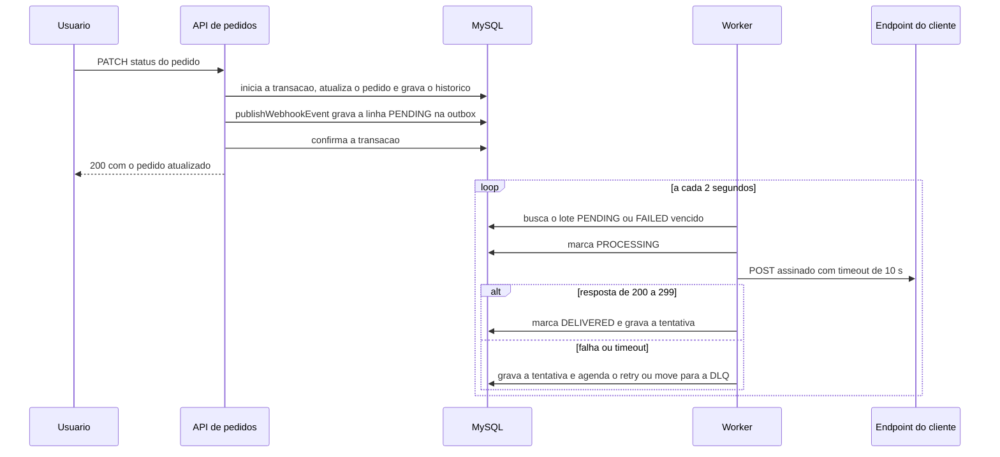
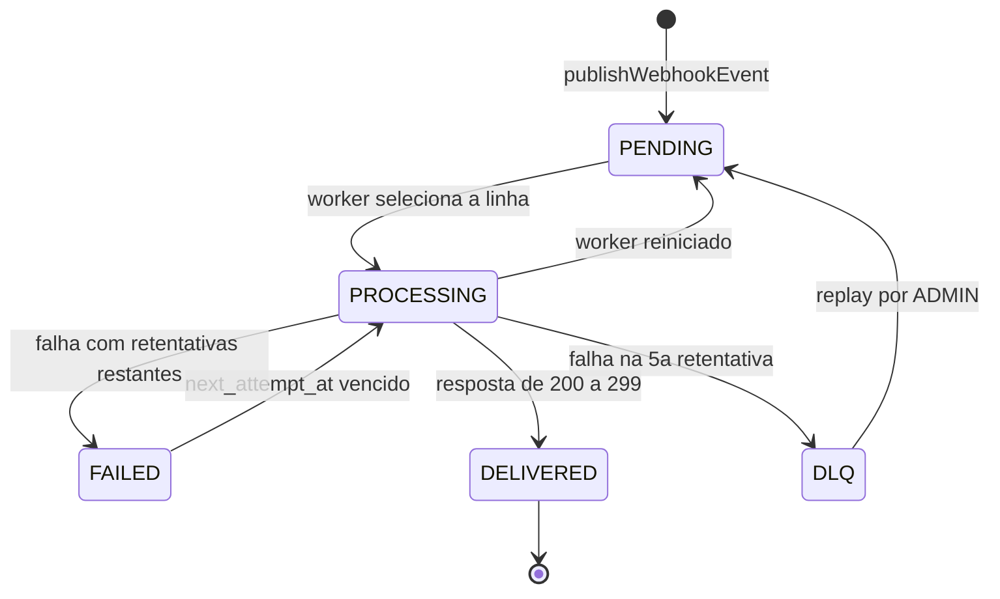

### FDD: Sistema de Webhooks de Notificação de Pedidos

Versão: 1.0
Data: 2026-10-17
Responsável: Vitor Oliveira

---

### 1. Contexto e motivação técnica

Três clientes B2B (Atlas Comercial, MaxDistribuição e Nova Cargo) consultam a listagem de pedidos de tempos em tempos para descobrir mudanças de status. Eles pediram notificação em menos de 10 segundos. A aplicação não tem hoje nenhum mecanismo de notificação externa: o `docker-compose.yml` sobe apenas o MySQL e o `package.json` não declara biblioteca de fila, de evento ou de cache.

O problema técnico é entregar um evento externo a partir da operação `changeStatus`, que roda em uma transação com validação de transição, movimentação de estoque, atualização do pedido e gravação do histórico. A entrega precisa de três propriedades ao mesmo tempo: o evento existe se, e somente se, a mudança de status for confirmada; um cliente lento ou fora do ar não atrasa nem desfaz a mudança de status; e o cliente consegue provar a origem e a integridade do conteúdo.

Este projeto não tem HLD. O encaixe é no monólito modular existente (Express, Prisma e MySQL): um módulo novo `webhooks` na API e um segundo processo, o worker, que usa o mesmo código, o mesmo banco e as mesmas variáveis de ambiente. As decisões estão nos ADRs 001 a 007 e a proposta resumida está no RFC-001.

Atores: o cliente B2B, que mantém um endpoint HTTPS e recebe os eventos; o usuário do sistema que representa o cliente, que cadastra webhooks pela API com o token JWT do sistema; o administrador (papel ADMIN), que reprocessa eventos da DLQ; a API; o worker.

Limites: o webhook é só de saída; a ordem de entrega vale por pedido e com um único worker; a garantia é at-least-once; o prazo é de 3 sprints com pelo menos 2 dias úteis de revisão de segurança no fim.

---

### 2. Objetivos técnicos
- Registrar o evento na mesma transação do `changeStatus`. Invariante: nenhuma mudança de status é confirmada sem uma linha na outbox para cada webhook ativo que assina o novo status. Medida: teste que força erro na gravação da outbox e confere que o pedido ficou no status anterior.
- Iniciar o primeiro envio em menos de 10 segundos depois do registro do evento. Medida: idade da linha PENDING mais antiga, com leitura do worker a cada 2 segundos. Hipótese: a meta vale quando nenhum cliente lento anterior atrasa o lote.
- Limitar cada chamada HTTP ao cliente a 10 segundos.
- Repetir falhas com esperas de 60, 300, 1.800, 7.200 e 43.200 segundos e mover o evento para a DLQ depois da 5ª retentativa. Medida: no máximo 6 requisições por ciclo de entrega (Hipótese: 1 envio inicial mais 5 retentativas) e janela total de 876 minutos.
- Assinar o corpo com HMAC-SHA256 usando uma secret única por endpoint, com rotação que mantém a secret anterior válida por 24 horas.
- Garantir entrega at-least-once com o header `X-Event-Id` estável entre as tentativas do mesmo evento.
- Recusar URL que não seja `https` e payload acima de 64 KB.
- Reaproveitar `AppError`, o error middleware, o Pino e `requireRole` sem alterá-los, com a única exceção da lista de redação do log.
- Hipótese: não acrescentar nenhuma dependência npm, porque `fetch`, `AbortSignal.timeout` e `crypto` do Node 20 bastam.

---

### 3. Escopo e exclusões

**Incluído**
- Módulo `webhooks` na API: cadastro, listagem, edição e remoção de webhooks, filtro de status por webhook, rotação de secret e histórico de entregas.
- Outbox gravada na transação do `changeStatus`, com o conteúdo do evento já renderizado.
- Worker em processo separado com polling de 2 segundos, timeout de 10 segundos, assinatura HMAC-SHA256 e headers de identificação.
- Retry com backoff, DLQ em tabela separada e reprocessamento manual por ADMIN com log de quem executou.
- Matriz de erros `WEBHOOK_*`, logs estruturados com Pino e testes automatizados no padrão de `tests/`.

**Excluído**
- Aviso por e-mail ao cliente quando o webhook falha (adiado para a próxima fase).
- Limitação da taxa de envio por cliente (a decisão é observar e decidir depois).
- Dashboard visual para o cliente (projeto do time de frontend).
- Arquivamento das linhas entregues depois de cerca de 30 dias.
- Mais de um worker, particionamento por pedido e lock pessimista.
- Webhook de entrada, em que o cliente enviaria eventos ao sistema.
- Endurecimento das permissões do CRUD de configuração e isolamento por customer.
- Evento na criação de pedido: a reunião integrou só a mudança de status (confirmação pendente com o PM).
- Circuit breaker.

---

### 4. Fluxos detalhados e diagramas
**Fluxo principal**
- **Criação do evento na outbox.** Dentro de `changeStatus`, depois de gravar o histórico e antes de reler o pedido, o código chama `publishWebhookEvent(tx, order, from, to)` com o `tx` da transação em andamento.
  - A função consulta os webhooks ativos cujo `customer_id` é igual a `order.customerId` e cujo campo `statuses` contém o novo status.
  - Para cada webhook encontrado, monta o payload com `event_id`, `event_type`, `timestamp`, `order_id`, `order_number`, `from_status`, `to_status`, `customer_id` e `total_cents`, sem os itens do pedido.
  - Serializa o payload e confere o tamanho: acima de 64 KB lança `WEBHOOK_PAYLOAD_TOO_LARGE`.
  - Insere uma linha PENDING com `attempts` 0 e `next_attempt_at` igual ao instante atual. O `id` da linha é o `event_id` e vira o header `X-Event-Id`.
  - Se nenhum webhook interessar, não insere nada. Qualquer erro propaga e a transação inteira é desfeita.
- **Processamento pelo worker.** A cada 2 segundos o worker executa um ciclo.
  - Busca um lote pequeno de linhas PENDING, ou FAILED com `next_attempt_at` vencido, ordenadas por `created_at`. Hipótese: lote de 10 linhas, valor que a reunião não definiu.
  - Marca cada linha como PROCESSING e a trata em sequência, uma por vez, para preservar a ordem por pedido. Consequência identificada na análise: um cliente lento atrasa em até 10 segundos cada evento seguinte do lote.
  - Carrega o webhook, calcula a assinatura HMAC-SHA256 do corpo e envia `POST` com os cinco headers e timeout de 10 segundos.
  - Resposta com status de 200 a 299 marca a linha como DELIVERED e grava a tentativa. Hipótese: qualquer outra resposta, erro de conexão ou timeout é falha.

**Fluxos alternativos e exceções**
- **Retry.** Em falha, o worker grava a tentativa e soma 1 em `attempts`.
  - Se ainda restarem retentativas, a linha vira FAILED com `next_attempt_at` igual ao instante atual mais a espera da posição: 1 minuto, 5 minutos, 30 minutos, 2 horas ou 12 horas, contados a partir da falha anterior.
  - Hipótese: o envio inicial mais as 5 retentativas somam no máximo 6 requisições por ciclo de entrega, e um replay inicia um novo ciclo.
- **DLQ.** Quando a 5ª retentativa falha, uma transação insere a linha em `webhook_dead_letter` com o payload, o motivo da falha e a data, e apaga a linha da outbox.
- **Replay.** O ADMIN chama o endpoint de replay.
  - Hipótese: uma transação recria a linha na outbox com o mesmo `id`, status PENDING e `attempts` 0, e preenche `replayed_at` na DLQ.
  - O log registra `webhook_replay_requested` com o `userId`, para auditoria. Hipótese: replay de linha já reprocessada devolve 409 `WEBHOOK_ALREADY_REPLAYED`.
- **Worker reiniciado.** Hipótese: ao iniciar, o worker devolve a PENDING as linhas em PROCESSING. A duplicata possível é coberta pelo at-least-once.
- **Webhook removido ou inativo no momento do envio.** Hipótese: o worker descarta o evento e registra `webhook_event_discarded`, sem enviar.
- **Payload acima de 64 KB.** Hipótese: a função de publicação lança `WEBHOOK_PAYLOAD_TOO_LARGE`, o `changeStatus` falha com 422 e a mudança de status é desfeita, coerente com a regra de que falha na outbox desfaz a mudança. Com os campos que a reunião definiu, o limite de 64 KB funciona como proteção e não deve ser atingido.
- **Encerramento.** Ao receber SIGTERM ou SIGINT, o worker termina o lote em andamento, desconecta o Prisma e sai.

**Diagramas**
- Sequência da criação do evento, do envio e do tratamento de falha:



- Estados da linha da outbox:



---

### 5. Contratos públicos (assinaturas, endpoints, headers, exemplos)
**Contrato 1: Cadastrar webhook**
- Tipo: endpoint
- Assinatura/Rota: POST /api/v1/webhooks
- Método: POST
- Semântica de status/headers:
  - 201: webhook criado. O corpo traz a secret, que só aparece nesta resposta e na rotação.
  - 400 `VALIDATION_ERROR`: corpo fora do schema, por exemplo status inexistente ou campo ausente.
  - 400 `WEBHOOK_INVALID_URL`: URL malformada ou diferente de `https`.
  - 401 `UNAUTHORIZED`: token ausente ou inválido.
  - 404 `NOT_FOUND`: customer inexistente.
  - Header `Authorization: Bearer <token>` obrigatório. Qualquer papel autenticado pode chamar.
  - O campo `statuses` aceita PAID, PROCESSING, SHIPPED, DELIVERED e CANCELLED. Hipótese: PENDING é recusado porque nenhuma transição leva a esse status.
  - Hipótese: a rota e o formato dos parâmetros são proposta do FDD; a reunião definiu o método e o objeto, e só as rotas do histórico e do replay.

**Exemplo de requisição**
```json
{
  "customerId": "5f0c6d0e-6b1f-4f3e-9a52-0e3f7a0c1d11",
  "url": "https://api.atlascomercial.example/webhooks/oms",
  "statuses": ["SHIPPED", "DELIVERED"]
}
```

**Exemplo de resposta**
```json
{
  "id": "0d7a3c58-2b64-4c7e-8e1f-6a9f4d2b1c33",
  "customerId": "5f0c6d0e-6b1f-4f3e-9a52-0e3f7a0c1d11",
  "url": "https://api.atlascomercial.example/webhooks/oms",
  "statuses": ["SHIPPED", "DELIVERED"],
  "active": true,
  "secret": "9f2c1a7e5b3d8046e1f7a2c9d4b68305f5e2a1c7d9b406283a5e7c1d9f2b4a60",
  "createdAt": "2026-10-17T12:00:00.000Z",
  "updatedAt": "2026-10-17T12:00:00.000Z"
}
```

**Contrato 2: Listar webhooks de um customer**
- Tipo: endpoint
- Assinatura/Rota: GET /api/v1/webhooks?customerId={uuid}&page={n}&pageSize={n}
- Método: GET
- Semântica de status/headers:
  - 200: lista paginada no formato `{ data, pagination }`, sem a secret.
  - 400 `VALIDATION_ERROR`: `customerId` ausente ou que não seja UUID, ou `pageSize` acima de 100.
  - 401 `UNAUTHORIZED`: token ausente ou inválido.
  - Hipótese: a rota e o formato dos parâmetros são proposta do FDD; a reunião definiu o método e o objeto, e só as rotas do histórico e do replay.

**Exemplo de requisição**
```http
GET /api/v1/webhooks?customerId=5f0c6d0e-6b1f-4f3e-9a52-0e3f7a0c1d11&page=1&pageSize=20
Authorization: Bearer <token>
```

**Exemplo de resposta**
```json
{
  "data": [
    {
      "id": "0d7a3c58-2b64-4c7e-8e1f-6a9f4d2b1c33",
      "customerId": "5f0c6d0e-6b1f-4f3e-9a52-0e3f7a0c1d11",
      "url": "https://api.atlascomercial.example/webhooks/oms",
      "statuses": ["SHIPPED", "DELIVERED"],
      "active": true,
      "createdAt": "2026-10-17T12:00:00.000Z",
      "updatedAt": "2026-10-17T12:00:00.000Z"
    }
  ],
  "pagination": { "page": 1, "pageSize": 20, "total": 1, "totalPages": 1 }
}
```

**Contrato 3: Editar webhook**
- Tipo: endpoint
- Assinatura/Rota: PATCH /api/v1/webhooks/:id
- Método: PATCH
- Semântica de status/headers:
  - 200: webhook atualizado, sem a secret. Todos os campos do corpo são opcionais: `url`, `statuses` e `active`.
  - 400 `VALIDATION_ERROR`: corpo fora do schema ou `id` que não seja UUID.
  - 400 `WEBHOOK_INVALID_URL`: nova URL malformada ou diferente de `https`.
  - 401 `UNAUTHORIZED`: token ausente ou inválido.
  - 404 `WEBHOOK_NOT_FOUND`: webhook inexistente.
  - A rota não altera a secret. A troca tem rota própria (Contrato 5).
  - Hipótese: a rota e o formato dos parâmetros são proposta do FDD; a reunião definiu o método e o objeto, e só as rotas do histórico e do replay.

**Exemplo de requisição**
```json
{
  "statuses": ["PAID", "SHIPPED", "DELIVERED"],
  "active": true
}
```

**Exemplo de resposta**
```json
{
  "id": "0d7a3c58-2b64-4c7e-8e1f-6a9f4d2b1c33",
  "customerId": "5f0c6d0e-6b1f-4f3e-9a52-0e3f7a0c1d11",
  "url": "https://api.atlascomercial.example/webhooks/oms",
  "statuses": ["PAID", "SHIPPED", "DELIVERED"],
  "active": true,
  "createdAt": "2026-10-17T12:00:00.000Z",
  "updatedAt": "2026-10-17T12:30:00.000Z"
}
```

**Contrato 4: Remover webhook**
- Tipo: endpoint
- Assinatura/Rota: DELETE /api/v1/webhooks/:id
- Método: DELETE
- Semântica de status/headers:
  - 204: webhook removido, sem corpo.
  - 401 `UNAUTHORIZED`: token ausente ou inválido.
  - 404 `WEBHOOK_NOT_FOUND`: webhook inexistente.
  - Hipótese: a remoção é física. Os eventos pendentes desse webhook são descartados pelo worker com o log `webhook_event_discarded`. Para parar o envio sem perder o cadastro, use `PATCH` com `active` falso.
  - Hipótese: a rota e o formato dos parâmetros são proposta do FDD; a reunião definiu o método e o objeto, e só as rotas do histórico e do replay.

**Exemplo de requisição**
```http
DELETE /api/v1/webhooks/0d7a3c58-2b64-4c7e-8e1f-6a9f4d2b1c33
Authorization: Bearer <token>
```

**Exemplo de resposta**
```http
HTTP/1.1 204 No Content
```

**Contrato 5: Rotacionar a secret**
- Tipo: endpoint
- Assinatura/Rota: POST /api/v1/webhooks/:id/secret/rotate
- Método: POST
- Semântica de status/headers:
  - 200: nova secret gerada e devolvida uma única vez. A secret anterior continua válida por 24 horas, até `previousSecretExpiresAt` (Hipótese de nome do campo).
  - 401 `UNAUTHORIZED`: token ausente ou inválido.
  - 404 `WEBHOOK_NOT_FOUND`: webhook inexistente.
  - Hipótese: o caminho `/secret/rotate` é proposta deste FDD, porque a reunião decidiu a capacidade e não a rota. Hipótese: a secret tem 32 bytes aleatórios em hexadecimal.

**Exemplo de requisição**
```http
POST /api/v1/webhooks/0d7a3c58-2b64-4c7e-8e1f-6a9f4d2b1c33/secret/rotate
Authorization: Bearer <token>
```

**Exemplo de resposta**
```json
{
  "id": "0d7a3c58-2b64-4c7e-8e1f-6a9f4d2b1c33",
  "secret": "b8d4e1a9c6f2073d5a1e9c7b3f0d6248c1a5e7d9b3f60482e1c7a5b9d3f0e682",
  "previousSecretExpiresAt": "2026-10-18T12:00:00.000Z"
}
```

**Contrato 6: Consultar o histórico de entregas**
- Tipo: endpoint
- Assinatura/Rota: GET /api/v1/webhooks/:id/deliveries?page={n}&pageSize={n}
- Método: GET
- Semântica de status/headers:
  - 200: tentativas de envio do webhook, da mais recente para a mais antiga, no formato `{ data, pagination }`. `pageSize` tem máximo de 100, o que atende ao pedido de ver os últimos 100 envios.
  - 400 `VALIDATION_ERROR`: `id` que não seja UUID ou `pageSize` acima de 100.
  - 401 `UNAUTHORIZED`: token ausente ou inválido.
  - 404 `WEBHOOK_NOT_FOUND`: webhook inexistente.
  - Hipótese: `responseBody` é guardado truncado em 2 KB.

**Exemplo de requisição**
```http
GET /api/v1/webhooks/0d7a3c58-2b64-4c7e-8e1f-6a9f4d2b1c33/deliveries?page=1&pageSize=100
Authorization: Bearer <token>
```

**Exemplo de resposta**
```json
{
  "data": [
    {
      "eventId": "3c1f0d52-7a1e-4d5b-9d0a-2f6c8b4e9a17",
      "attempt": 1,
      "success": true,
      "statusCode": 200,
      "responseBody": "{\"received\":true}",
      "durationMs": 184,
      "payload": {
        "event_id": "3c1f0d52-7a1e-4d5b-9d0a-2f6c8b4e9a17",
        "event_type": "order.status_changed",
        "timestamp": "2026-10-17T12:00:00.000Z",
        "order_id": "a4c9e2f1-7d3b-4a68-b5c0-91e8d6f3a2b7",
        "order_number": "ORD-000123",
        "from_status": "PROCESSING",
        "to_status": "SHIPPED",
        "customer_id": "5f0c6d0e-6b1f-4f3e-9a52-0e3f7a0c1d11",
        "total_cents": 129900
      },
      "createdAt": "2026-10-17T12:00:03.304Z"
    }
  ],
  "pagination": { "page": 1, "pageSize": 100, "total": 1, "totalPages": 1 }
}
```

**Contrato 7: Reprocessar evento da DLQ**
- Tipo: endpoint
- Assinatura/Rota: POST /api/v1/admin/webhooks/dead-letter/:id/replay
- Método: POST
- Semântica de status/headers:
  - 200: o evento voltou para a outbox como PENDING. Hipótese: com o mesmo `eventId`.
  - 401 `UNAUTHORIZED`: token ausente ou inválido.
  - 403 `FORBIDDEN`: o usuário não tem o papel ADMIN.
  - 404 `WEBHOOK_DEAD_LETTER_NOT_FOUND`: linha da DLQ inexistente.
  - 409 `WEBHOOK_ALREADY_REPLAYED`: a linha já foi reprocessada. Hipótese: um reprocessamento por linha.
  - O log `webhook_replay_requested` registra o `userId` de quem executou, para auditoria.

**Exemplo de requisição**
```http
POST /api/v1/admin/webhooks/dead-letter/e91b4a26-5c3f-4d87-a1b2-7f0c3d9e6a54/replay
Authorization: Bearer <token de ADMIN>
```

**Exemplo de resposta**
```json
{
  "eventId": "7b2e9a10-4c5d-4f3a-8e61-b0d3c9a1f2e5",
  "webhookId": "0d7a3c58-2b64-4c7e-8e1f-6a9f4d2b1c33",
  "status": "PENDING",
  "replayedAt": "2026-10-18T09:00:00.000Z"
}
```

**Contrato 8: Entrega do evento ao endpoint do cliente**
- Tipo: endpoint
- Assinatura/Rota: POST {url cadastrada no webhook}
- Método: POST
- Semântica de status/headers:
  - Hipótese: 200 a 299 é entrega com sucesso, e qualquer outra resposta, erro de conexão ou ausência de resposta em 10 segundos é falha e segue o retry.
  - `Content-Type: application/json`.
  - `X-Event-Id`: UUID do evento, igual em todas as tentativas, para o cliente deduplicar.
  - `X-Webhook-Id`: id do webhook que originou o envio, para o cliente que tem vários cadastros.
  - `X-Timestamp`: instante do envio, para o cliente detectar replay. Hipótese: formato ISO 8601. O header não faz parte da assinatura.
  - `X-Signature`: HMAC-SHA256 do corpo exato da requisição com a secret do endpoint. Hipótese: hexadecimal em minúsculas; durante as 24 horas de rotação, duas assinaturas separadas por vírgula, a da secret nova primeiro.
  - Limite de 64 KB para o corpo. Os itens do pedido não vão no payload.

**Exemplo de requisição**
```http
POST /webhooks/oms HTTP/1.1
Host: api.atlascomercial.example
Content-Type: application/json
X-Event-Id: 3c1f0d52-7a1e-4d5b-9d0a-2f6c8b4e9a17
X-Webhook-Id: 0d7a3c58-2b64-4c7e-8e1f-6a9f4d2b1c33
X-Timestamp: 2026-10-17T12:00:03.120Z
X-Signature: c0b3f6a1d94e27850e1a7c3b9d6f2084a5e1c7b3d90f6428e1a7c5b3d9f06a42

{"event_id":"3c1f0d52-7a1e-4d5b-9d0a-2f6c8b4e9a17","event_type":"order.status_changed","timestamp":"2026-10-17T12:00:00.000Z","order_id":"a4c9e2f1-7d3b-4a68-b5c0-91e8d6f3a2b7","order_number":"ORD-000123","from_status":"PROCESSING","to_status":"SHIPPED","customer_id":"5f0c6d0e-6b1f-4f3e-9a52-0e3f7a0c1d11","total_cents":129900}
```

**Exemplo de resposta**
```http
HTTP/1.1 200 OK
Content-Type: application/json

{"received":true}
```

**Contrato 9: Publicação do evento dentro da transação**
- Tipo: function
- Assinatura/Rota: publishWebhookEvent(tx: Prisma.TransactionClient, order: Order, fromStatus: OrderStatus, toStatus: OrderStatus): Promise<void>
- Método: chamada de função dentro da transação de `changeStatus`
- Semântica de status/headers:
  - Retorna sem valor quando termina. O efeito é uma linha PENDING na outbox para cada webhook ativo do customer que assina `toStatus`.
  - Lança `WEBHOOK_PAYLOAD_TOO_LARGE` se o payload passar de 64 KB.
  - Não captura erros do banco: qualquer falha propaga e desfaz a transação.
  - Não recebe o repository de webhooks. Usa apenas o `tx` recebido.

**Exemplo de requisição**
```json
{
  "order": { "id": "a4c9e2f1-7d3b-4a68-b5c0-91e8d6f3a2b7", "orderNumber": "ORD-000123", "customerId": "5f0c6d0e-6b1f-4f3e-9a52-0e3f7a0c1d11", "totalCents": 129900 },
  "fromStatus": "PROCESSING",
  "toStatus": "SHIPPED"
}
```

**Exemplo de resposta**
```text
Promise<void> resolvida. Efeito: 1 linha PENDING na outbox para o webhook 0d7a3c58-2b64-4c7e-8e1f-6a9f4d2b1c33.
```

---

### 6. Erros, exceções e fallback
- Matriz de erros previstos e tratamentos

| Código | Condição | Status HTTP | Tratamento | Notas |
| --- | --- | --- | --- | --- |
| `WEBHOOK_NOT_FOUND` | Webhook inexistente | 404 | Subclasse de `AppError` com código próprio, no padrão de `InvalidStatusTransitionError` | Citado em [09:28] Bruno; `NotFoundError` tem código fixo e não serve |
| `WEBHOOK_INVALID_URL` | URL malformada ou diferente de `https` | 400 | Hipótese: `BadRequestError` com o código próprio e o service interpreta a URL, em vez de `VALIDATION_ERROR` do schema Zod; a reunião citou os dois comportamentos | Citado em [09:28] Bruno; origem da regra em [09:23] Sofia |
| `WEBHOOK_SECRET_REQUIRED` | Hipótese: webhook sem secret ativa no momento do envio | interno | A tentativa conta como falha e segue o retry | Citado em [09:28] Bruno sem semântica definida |
| `WEBHOOK_PAYLOAD_TOO_LARGE` | Payload acima de 64 KB na gravação do evento | 422 | Hipótese: `UnprocessableEntityError` com status 422 e transação de `changeStatus` desfeita | Limite de [09:24] Larissa; erro em vez de truncar, por [09:23] Sofia; nome proposto pelo FDD |
| `WEBHOOK_DEAD_LETTER_NOT_FOUND` | Replay de linha da DLQ inexistente | 404 | Subclasse de `AppError` com código próprio | Derivado do endpoint de replay de [09:18] Diego; nome proposto pelo FDD |
| `WEBHOOK_ALREADY_REPLAYED` | Hipótese: replay de linha da DLQ já reprocessada | 409 | `ConflictError` com código próprio | Evita recriar uma linha de outbox com o mesmo `id` |
| `WEBHOOK_DELIVERY_TIMEOUT` | O cliente não respondeu em 10 segundos | interno | Falha da tentativa; segue o retry | Timeout de [09:42] Diego; nome proposto pelo FDD |
| `WEBHOOK_DELIVERY_FAILED` | Resposta fora de 200 a 299 ou erro de conexão | interno | Falha da tentativa; segue o retry | Política de retry de [09:15] Diego; nome proposto pelo FDD |
| `WEBHOOK_RETRIES_EXHAUSTED` | A última retentativa falhou | interno | Move para a DLQ e guarda o código da última falha como motivo | [09:17] Larissa e [09:18] Diego; nome proposto pelo FDD |

Códigos existentes reaproveitados sem alteração: `VALIDATION_ERROR`, `UNAUTHORIZED`, `FORBIDDEN`, `NOT_FOUND`, `INTERNAL_SERVER_ERROR`.

- Estratégias de resiliência: timeouts, retries, backoff e fallback
  - Timeout: 10 segundos por chamada HTTP, com `AbortSignal.timeout(10000)` do Node 20. O estouro gera `WEBHOOK_DELIVERY_TIMEOUT`.
  - Retries: Hipótese de interpretação, 5 retentativas depois do envio inicial, no máximo 6 requisições por ciclo de entrega. Um replay inicia um novo ciclo.
  - Backoff: 60, 300, 1.800, 7.200 e 43.200 segundos, contados a partir da falha anterior. A soma é de 876 minutos, cerca de 14,6 horas.
  - Fallback: depois da 5ª retentativa o evento vai para a DLQ e só volta por reprocessamento manual de ADMIN.
  - Circuit breaker: não previsto nesta fase, porque a reunião não o discutiu.
  - Hipótese: o worker não segue redirecionamentos HTTP, para que um endereço cadastrado não leve o servidor a outro destino.
  - Encerramento ordenado: ao receber SIGTERM ou SIGINT, o worker termina o lote em andamento antes de sair, o que o `shutdown` de `src/server.ts` não faz hoje.
- Política de fallback
  - Falha permanente: o evento fica na DLQ com payload, motivo e data, como evidência para depuração e reprocessamento.
  - Aviso ao cliente: o e-mail ficou fora desta fase, então o cliente não é notificado da falha. O caminho disponível é o histórico de entregas.
  - Hipótese: webhook removido ou inativo no envio descarta o evento com o log `webhook_event_discarded`.
- Invariantes:
  - Não existe status confirmado sem evento para webhook ativo que assina o status, nem evento sem status confirmado.
  - O `event_id` é único, nasce na gravação da outbox e é o mesmo em todas as tentativas e no replay.
  - A ordem de entrega vale por `order_id` e só com um único worker. Limitação identificada na análise: um evento em espera de retry pode ser ultrapassado pelo seguinte do mesmo pedido.
  - Hipótese: a secret nunca aparece em logs nem em leituras, e só as respostas de criação e de rotação a devolvem.
  - Hipótese: nenhuma linha da DLQ é apagada, porque a reunião a descreve como evidência para depuração e reprocessamento.

---

### 7. Observabilidade
Métricas
- Hipótese: a reunião não discutiu métricas e o projeto não tem biblioteca de métricas, então elas saem como logs estruturados do Pino e como consultas SQL.
- Linhas da outbox por situação (PENDING, PROCESSING, FAILED, DELIVERED), emitidas a cada ciclo do worker.
- Idade da linha PENDING mais antiga, que mede o objetivo de menos de 10 segundos.
- Quantidade de linhas na DLQ.
- Tentativas por resultado: sucesso, falha e timeout.
- Duração das chamadas HTTP em milissegundos (`durationMs`).

Logs
- Formato: JSON do Pino, com o logger de `src/shared/logger/index.ts`. Os nomes de evento seguem o estilo snake_case de `http_request` e `server_started`.
- Eventos: `webhook_event_enqueued`, `webhook_delivery_attempted`, `webhook_delivery_succeeded`, `webhook_delivery_failed`, `webhook_moved_to_dead_letter`, `webhook_replay_requested`, `webhook_event_discarded`, `webhook_worker_started` e `webhook_worker_shutdown`.
- Campos: `eventId`, `webhookId`, `orderId`, `attempt`, `statusCode`, `durationMs` e `userId` (no replay).
- Proteção de dados: a lista de redação passa a incluir `*.secret` e `*.previous_secret`, e o worker guarda o corpo da resposta do cliente truncado em 2 KB (Hipótese).

Tracing
- Hipótese: o projeto não tem biblioteca de tracing e a reunião mandou reaproveitar o que existe, então não há spans nesta fase.
- Correlação: o `requestId` de `src/middlewares/request-logger.middleware.ts` identifica a chamada à API, e o `eventId` identifica o evento do registro na outbox até a entrega e o replay.

Dashboards e alertas
- Nenhum painel nesta fase. O dashboard visual da reunião é para o cliente e está fora do escopo.
- Hipótese de alertas mínimos: idade da linha PENDING mais antiga acima de 10 segundos e DLQ com mais de 0 linhas.

---

### 8. Dependências e compatibilidade

| Versão mínima | Componente | Observações |
| --- | --- | --- |
| 20 | Node.js | `engines.node` em `package.json`; `fetch`, `AbortSignal.timeout` e `crypto` nativos dispensam biblioteca |
| 8.0 | MySQL | Imagem `mysql:8.0` em `docker-compose.yml`; único banco, sem Redis nem broker |
| 5.22.0 | Prisma | `@prisma/client` e `prisma`; migration aditiva; `PrismaClient` próprio no worker |
| 4.21.1 | Express | Rotas montadas em `/api/v1`; corpo JSON limitado a 1 MB na entrada |
| 3.23.8 | Zod | Schemas de corpo, params e query validados por `validate` |
| 9.5.0 | Pino | Logger único da API e do worker |
| 11.0.3 | uuid | Geração dos identificadores UUID; o banco também usa `uuid()` do Prisma |
| 2.1.4 | Vitest | Testes no padrão de `tests/`, com supertest 7.0.0 |

Garantias de compatibilidade
- Os endpoints existentes não mudam, e a resposta de sucesso de `changeStatus` também não. Hipótese: o erro 422 `WEBHOOK_PAYLOAD_TOO_LARGE` é novo e só ocorre se o payload passar de 64 KB.
- A migration é aditiva: cria tabelas novas e não altera as existentes.
- Hipótese: nenhuma dependência npm é adicionada, porque os recursos nativos do Node 20 bastam.
- O envelope de erro `{ error: { code, message, details } }` e o formato de paginação `{ data, pagination }` são os mesmos do restante da API.
- Os campos da API de configuração usam camelCase como o restante da API. O payload e os headers do evento usam os nomes decididos na reunião, em snake_case no payload.

---

### 9. Critérios de aceite técnicos
- Atomicidade: forçar erro na gravação da outbox dentro de `changeStatus` deixa o pedido no status anterior e sem linha no histórico.
- Filtro: para um customer com dois webhooks, um que assina SHIPPED e outro que não, a mudança para SHIPPED cria exatamente 1 linha na outbox.
- Assinatura: o HMAC-SHA256 calculado pelo teste com a secret do endpoint é igual ao valor de `X-Signature`.
- Backoff: as esperas são 60, 300, 1.800, 7.200 e 43.200 segundos, e a falha da 6ª requisição move o evento para a DLQ, conforme a interpretação de 5 retentativas depois do envio inicial.
- Timeout: um servidor simulado que responde depois de 10 segundos gera uma tentativa com falha `WEBHOOK_DELIVERY_TIMEOUT`.
- Replay: ADMIN recebe 200 e a linha volta a PENDING; OPERATOR recebe 403. Hipótese: o replay mantém o mesmo `eventId` e um segundo replay da mesma linha recebe 409.
- Payload (Hipótese de comportamento): um payload artificial de 64 KB mais 1 byte, montado em teste unitário, lança `WEBHOOK_PAYLOAD_TOO_LARGE` e a mudança de status é desfeita.
- Secret (Hipótese de requisito): `GET` de webhook nunca devolve a secret; a criação e a rotação devolvem.
- Logs (Hipótese de requisito): a secret não aparece em nenhuma linha de log produzida pelo módulo.
- Latência: com o worker ligado e um cliente simulado que responde em menos de 1 segundo, o primeiro envio ocorre em menos de 10 segundos depois do registro do evento.
- Regressão: os testes existentes em `tests/` continuam passando.
- Ordem: com um worker e nenhum envio falhando, 3 mudanças de status do mesmo pedido chegam na ordem de `created_at`.

---

### 10. Riscos e mitigação
### Cliente fora do ar por mais de 14,6 horas
- Probabilidade: média
- Impacto: o cliente fica sem eventos até o reprocessamento manual, e não é avisado da falha.
- Mitigação:
  - Histórico de entregas por webhook.
  - DLQ com payload, motivo e data.
  - Reprocessamento por ADMIN.
- Plano de contingência: o ADMIN reprocessa a DLQ quando o cliente voltar.
### Ordem fora de sequência
- Probabilidade: média
- Impacto: o cliente recebe estados de um pedido fora da sequência, com evento em retry ou com mais de um worker.
- Mitigação:
  - Um único worker.
  - Payload com `from_status` e `to_status`.
  - Limitação documentada para os clientes no portal.
- Plano de contingência: particionar por pedido ou usar lock pessimista, hoje adiado.
### Vazamento de secret
- Probabilidade: média
- Impacto: terceiros forjam notificações para o endpoint afetado.
- Mitigação:
  - Secret por endpoint.
  - Rotação com 24 horas de sobreposição.
  - Hipótese: redação de `*.secret` e `*.previous_secret` no log e secret só nas respostas de criação e de rotação.
- Plano de contingência: rotacionar a secret do endpoint afetado.
### Evento duplicado em cliente que não deduplica
- Probabilidade: alta
- Impacto: o cliente processa o mesmo pedido duas vezes.
- Mitigação:
  - `X-Event-Id` em todo envio.
  - Documentação destacada no portal do desenvolvedor.
- Plano de contingência: o suporte orienta o cliente a deduplicar por `X-Event-Id`.
### Worker parado
- Probabilidade: baixa
- Impacto: os eventos se acumulam e a notificação passa de 10 segundos.
- Mitigação:
  - Processo separado da API.
  - Alerta pela idade da linha PENDING mais antiga (Hipótese).
- Plano de contingência: reiniciar o worker; as linhas pendentes saem em ordem de `created_at`.
### Acesso a webhooks de qualquer customer
- Probabilidade: média
- Impacto: qualquer usuário autenticado altera ou lê a configuração e o histórico de outro cliente, porque o token não identifica o customer.
- Mitigação:
  - Risco aceito pela reunião para esta fase.
  - Revisão de segurança antes do deploy.
- Plano de contingência: endurecer as permissões do CRUD, hoje adiado.
### Endereço cadastrado aponta para a rede interna
- Probabilidade: baixa
- Impacto: o servidor faz requisições a serviços internos por conta de um endereço cadastrado.
- Mitigação:
  - Hipótese: não seguir redirecionamentos.
  - Análise da revisão de segurança sobre destinos permitidos.
- Plano de contingência: desativar o webhook com `active` falso.
### Falha na gravação da outbox desfaz a mudança de status
- Probabilidade: baixa
- Impacto: o pedido não muda de status enquanto a gravação da outbox falhar.
- Mitigação:
  - É o comportamento decidido: nunca status sem evento.
  - Testes de atomicidade e índices na outbox.
- Plano de contingência: corrigir a causa na outbox; o pedido pode repetir a mudança depois.
### Cliente lento atrasa os eventos seguintes do lote
- Probabilidade: média
- Impacto: o worker trata um evento por vez e cada chamada pode levar até 10 segundos, então os eventos seguintes do lote saem depois da meta de 10 segundos.
- Mitigação:
  - Lote pequeno por ciclo (Hipótese: 10 linhas).
  - Timeout de 10 segundos por chamada, que limita o atraso por evento.
- Plano de contingência: processar em paralelo eventos de pedidos diferentes, mantendo a ordem por pedido, hoje adiado por causa do worker único.

---

### 11. Integração com o sistema existente

| Caminho | Situação atual | Integração do módulo de webhooks |
| --- | --- | --- |
| `src/modules/orders/order.service.ts:126` | `changeStatus` abre a transação em L131, grava o histórico em L159 a L167 e relê o pedido em L169 | Chama `publishWebhookEvent(tx, order, from, to)` depois do histórico e antes da releitura, na mesma transação. Erros propagam e desfazem tudo |
| `src/modules/orders/order.service.ts:24` | `TxClient` é `Prisma.TransactionClient` e o construtor recebe `orders` e `prisma` | A função de publicação recebe o `tx` tipado como `Prisma.TransactionClient`; o alias local `TxClient` não é exportado. O construtor e `buildControllers` não mudam |
| `src/modules/orders/order.service.ts:181` | `delete` só aceita pedido PENDING ou CANCELLED | A outbox guarda `order_id` sem chave estrangeira, para o evento sobreviver à remoção do pedido |
| `src/modules/orders/order.status.ts:3` | O mapa de transições não tem PENDING como destino | Hipótese: o schema de `statuses` usa `z.enum` com PAID, PROCESSING, SHIPPED, DELIVERED e CANCELLED |
| `prisma/schema.prisma:74` | Ids `Char(36)` com `uuid()`, `@@map` em snake_case, enum `OrderStatus` na L16 | Quatro modelos novos no mesmo padrão (ver o modelo de dados abaixo) |
| `prisma/migrations/20260519182739_init/migration.sql` | Única migration, com `DATETIME(3)` e charset utf8mb4 | Nova migration aditiva gerada por `npm run db:migrate` |
| `src/shared/errors/app-error.ts:3` | `AppError(message, statusCode, errorCode, details)` | Base das subclasses de `WEBHOOK_NOT_FOUND` e `WEBHOOK_DEAD_LETTER_NOT_FOUND` |
| `src/shared/errors/http-errors.ts:27` | `NotFoundError` tem código fixo; `BadRequestError`, `ConflictError` e `UnprocessableEntityError` aceitam `code`; `InvalidStatusTransitionError` na L45 é o modelo de subclasse | `WEBHOOK_INVALID_URL` por `BadRequestError`, `WEBHOOK_PAYLOAD_TOO_LARGE` por `UnprocessableEntityError`, `WEBHOOK_ALREADY_REPLAYED` (Hipótese) por `ConflictError`, e subclasses de `AppError` para os dois "não encontrado" |
| `src/middlewares/error.middleware.ts:14` | Trata `AppError`, `ZodError`, Prisma P2002 e P2025; o resto vira 500 | Sem alteração. O erro Prisma P2003 não é tratado, e por isso a outbox não usa chave estrangeira para `orders` |
| `src/middlewares/auth.middleware.ts:49` | `authenticate` e `requireRole`; o JWT tem `sub`, `email` e `role`, sem customer; `src/modules/users/user.routes.ts:15` é o único uso de `requireRole('ADMIN')` | O CRUD usa `authenticate`. O replay usa `authenticate` e `requireRole('ADMIN')`, como em `user.routes.ts` |
| `src/middlewares/validate.middleware.ts:11` | Falha do Zod vira `ValidationError` com `VALIDATION_ERROR` | Cada rota usa `validate({ params, query, body })` com schemas de `webhook.schemas.ts` |
| `src/modules/orders/order.schemas.ts:23` | `page` e `pageSize` (máximo 100), campos em camelCase, `src/shared/http/response.ts:22` com `paginated` | Listas de webhooks e de entregas usam o mesmo schema de paginação e a mesma resposta `{ data, pagination }` |
| `src/routes/index.ts:13` | Tipo `Controllers` e montagem de cada router (o prefixo `/api/v1` vem de `src/app.ts:67`) | Acrescenta `webhooks` ao tipo e monta `/webhooks` e `/admin/webhooks` |
| `src/app.ts:26` | `buildControllers` cria repository, service e controller de cada módulo | Instancia o repository, o service e o controller de webhooks |
| `src/shared/logger/index.ts:4` | `redactPaths` não inclui `secret`; `src/middlewares/request-logger.middleware.ts:5` define o estilo dos eventos de log | Acrescenta `*.secret` e `*.previous_secret` à redação (Hipótese) e nomeia os eventos em snake_case |
| `src/server.ts:6` | `bootstrap` e `shutdown` com SIGINT e SIGTERM | `src/worker.ts` (arquivo novo) segue o padrão e termina o lote antes de sair |
| `src/config/database.ts:4` | `createPrismaClient` e o `prisma` exportado | O worker importa daqui e obtém seu `PrismaClient`, por ser outro processo |
| `src/config/env.ts:3` | `envSchema` exige `DATABASE_URL` e `JWT_SECRET` | O worker lê o mesmo `env` e, por isso, exige `JWT_SECRET` sem usá-lo. Hipótese: manter assim |
| `package.json:10` | Scripts `dev`, `build`, `start`, `db:*` e `test`, sem script de worker; `tsconfig.build.json` compila `src/**/*.ts` | Acrescenta o script `worker` (`tsx --env-file=.env src/worker.ts`). Hipótese: em produção, `node --env-file=.env dist/worker.js` depois de `npm run build` |
| `tests/setup.ts:8` | `beforeEach` apaga as tabelas em ordem; `tests/helpers/factories.ts:76` cria usuário autenticado por papel | Inclui as tabelas de webhook na limpeza e usa ADMIN e OPERATOR nos testes de replay |
| `src/worker.ts` (arquivo novo) | Não existe | Entrada do worker: carrega o `env`, cria o ciclo de 2 segundos e trata SIGTERM e SIGINT |
| `src/modules/webhooks/webhook.controller.ts`, `src/modules/webhooks/webhook.service.ts`, `src/modules/webhooks/webhook.repository.ts`, `src/modules/webhooks/webhook.routes.ts`, `src/modules/webhooks/webhook.schemas.ts` (arquivos novos) | Não existem | Módulo no mesmo formato de `src/modules/orders` |
| `src/modules/webhooks/webhook.publisher.ts` (arquivo novo) | Não existe | Contém `publishWebhookEvent` (Contrato 9) |
| `src/modules/webhooks/webhook.worker.ts` (arquivo novo) | Não existe | Lógica de processamento, retry e DLQ. Hipótese: este nome, entre `webhook.worker.ts` e `webhook.processor.ts`, citados na reunião |

Hipótese de desenho: as colunas abaixo decorrem dos fluxos da seção 4. A reunião citou apenas `status` e `created_at` da outbox, os campos url, secret, customer_id e ativo da configuração, e o conteúdo, o motivo da falha e a data da DLQ.

**Modelo de dados novo (migration aditiva)**
- `webhook_endpoints`: Hipótese de nome. Colunas `id` UUID, `customer_id`, `url`, `secret`, `previous_secret`, `previous_secret_expires_at`, `statuses` (lista JSON), `active`, `created_at` e `updated_at`. Hipótese: `customer_id` referencia `customers` com exclusão em cascata.
- `webhook_outbox`: colunas `id` UUID (igual ao `event_id`), `webhook_id`, `order_id` (sem chave estrangeira), `event_type`, `payload` (JSON, snapshot), `status` (PENDING, PROCESSING, FAILED, DELIVERED), `attempts`, `next_attempt_at`, `created_at` e `updated_at`. Índices em `status`, em `created_at` e em (`status`, `next_attempt_at`).
- `webhook_dead_letter`: colunas `id` UUID, `event_id`, `webhook_id`, `payload`, `failure_reason`, `failed_at` e `replayed_at`.
- `webhook_deliveries`: Hipótese de nome. Colunas `id` UUID, `event_id`, `webhook_id`, `attempt`, `success`, `status_code`, `response_body` (Hipótese: truncado em 2 KB), `duration_ms` e `created_at`. Guarda uma linha por tentativa e alimenta o Contrato 6.
